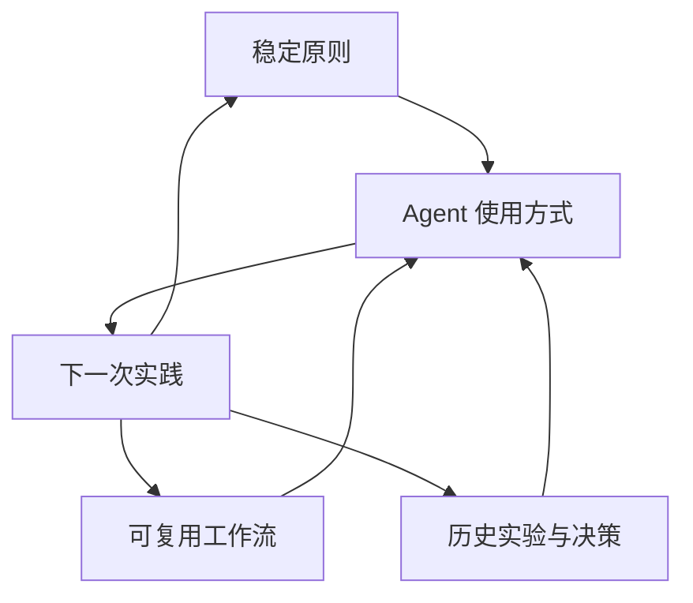

# Agent Craft

这里记录我在长期使用 Agent 时形成的个人方法：哪些习惯已经稳定，哪些工作流值得复用，
哪些判断正在被实验修正，以及这些认识如何一步步演化。

这个仓库不是提示词收藏夹。它更接近一份持续维护的个人操作手册：

- **原则**回答“什么情况下应该怎么做”
- **工作流**回答“同一类任务怎样稳定完成”
- **实验与决策**回答“为什么后来改了做法”
- **演进记录**保留变化过程，而不只保留最后结论

## 仓库地图

| 目录 | 用途 | 更新方式 |
|---|---|---|
| `principles/` | 稳定的个人使用原则与判断标准 | 行为方式改变时修订 |
| `playbooks/` | 可重复执行的任务流程 | 实际执行后沉淀 |
| `experiments/` | 有假设、有证据的使用实验 | 每次实验单独记录 |
| `decisions/` | 重要取舍及其背景 | 只追加新决策，不改写历史 |
| `evolution/` | 时间线与阶段性思想演进 | 持续追加 |
| `templates/` | 新记录的统一模板 | 结构与字段变化时修订 |

## 运行方式

原则不应该替实践下结论，实践也不应该被写成没有证据的成功故事。每次有价值的实践，
都应回答三个问题：

1. 我原本期待什么？
2. 实际发生了什么？
3. 以后要不要改变原则或工作流？

## 从哪里开始

- 查看当前做法：[Agent 使用原则](principles/agent-operating-principles.md)
- 查找可复用流程：[工作流索引](playbooks/README.md)
- 了解变化过程：[可视化演进](evolution/visual-history.md)
- 新建一条记录：[模板](templates/README.md)

## 维护约定

- 稳定结论放入 `principles/`，不要藏在日记里。
- 一次性任务只在产生可复用方法后进入 `playbooks/`。
- 过去的判断与时间线不删除；结论改变时新增决策或演进记录。
- 私人环境、凭据和会话内容不进入仓库。
- 对外发布文章时使用经过整理的公开版本。

---

© 2026 CommitByRyan. All rights reserved.
